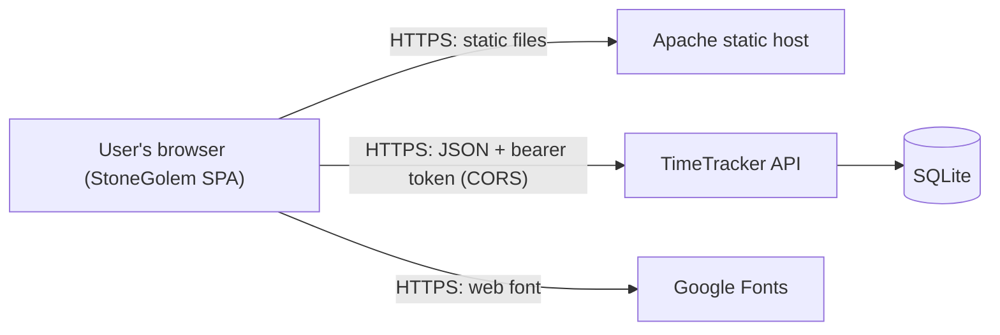
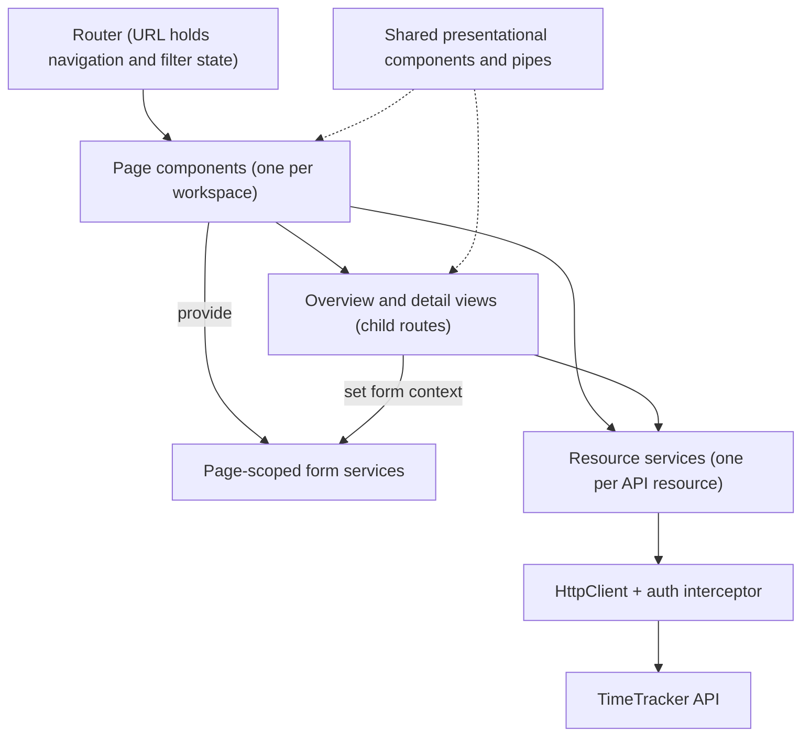
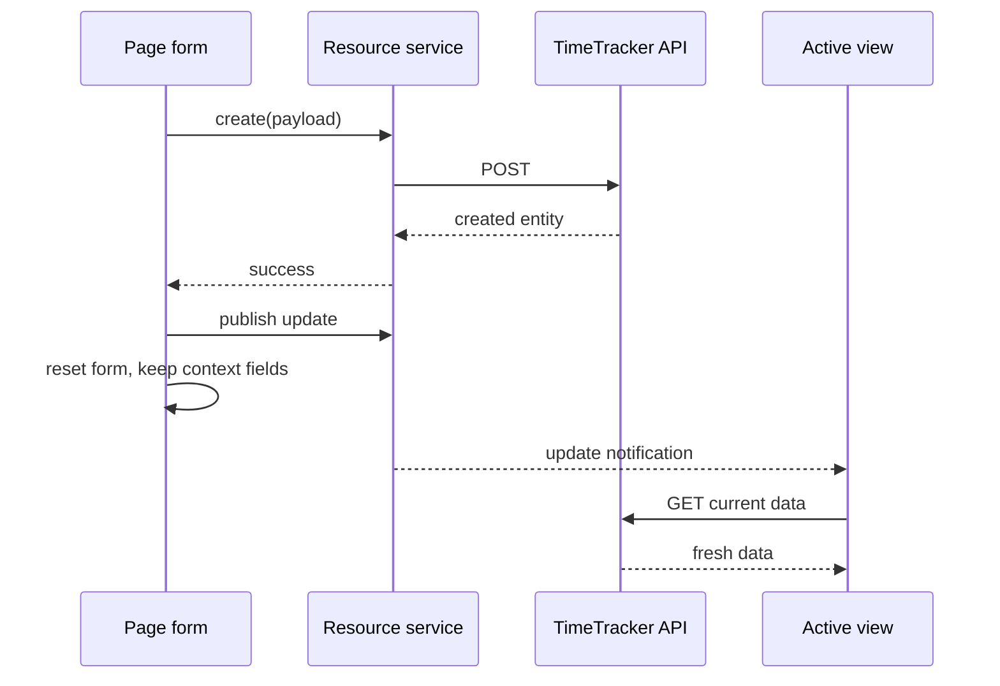
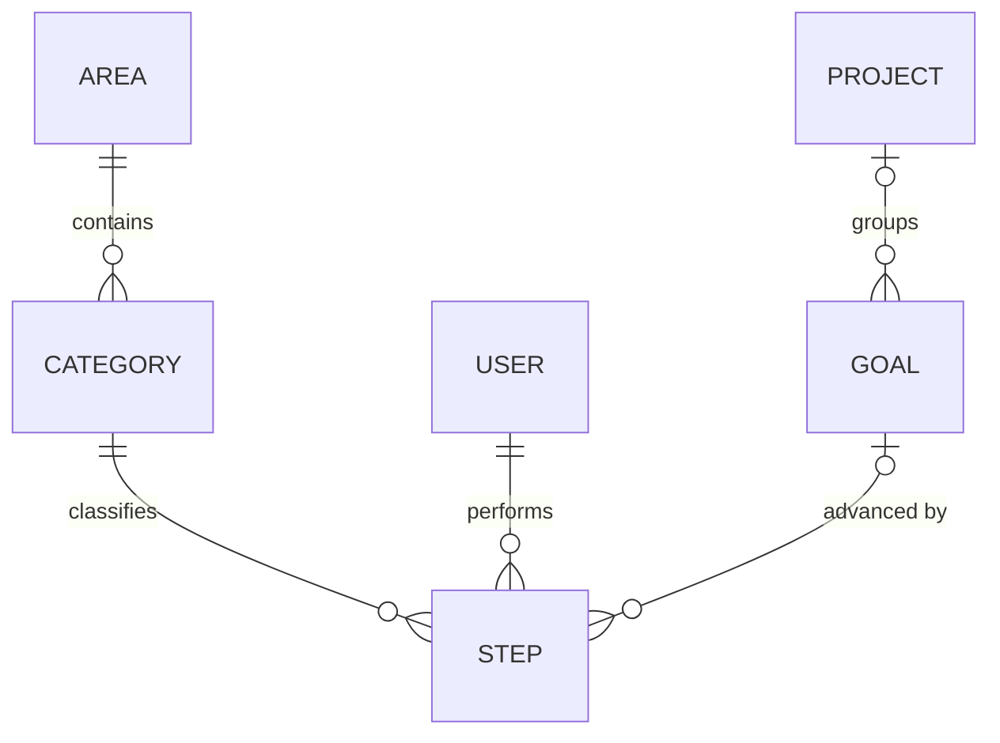
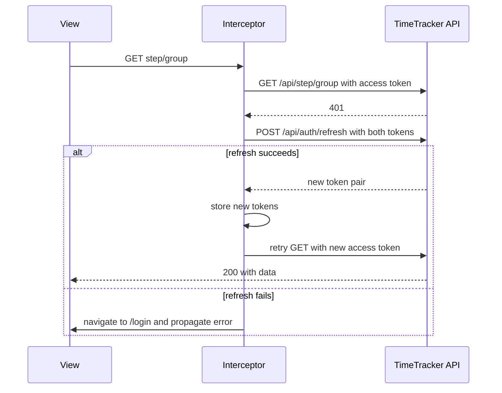
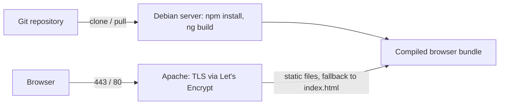

# StoneGolem — Design Document

StoneGolem is the web client of the TimeTracker system. It is a single-page application that talks to the TimeTracker
REST API (the **EarthGolem** project). This document describes the client's purpose, architecture, navigation, data
flow, interaction design, session handling, visual design system and runtime environment. It focuses on stable design
decisions rather than implementation details that change frequently.

---

## 1. Purpose and Scope

StoneGolem lets a small, trusted group of users, such as a household, record and review how they spend their time.
The central record is a **step**: a duration of work done by a user on a given day. Every step is classified by a
**category** (categories are grouped into **areas**) and may contribute to a **goal** (goals may be grouped into
**projects**).

The client provides three workspaces:

| Workspace | Purpose |
|---|---|
| **Steps** | Record steps and review them day by day. Soft-delete, restore and permanently delete steps. |
| **Goals** | Create goals, optionally together with a new project. Review goals per project, open and close goals and projects, delete unused goals. |
| **Categories** | Create categories, optionally together with a new area. Review categories per area, delete unused categories. |

Design boundaries:

- The client contains no rules that define data. Derived values are computed by the server and only displayed by the
  client. Examples are goal and project timelines, step counters and the removal of parents that lost their last child.
- The interaction model is **create, toggle and delete**. Existing records are not edited in place.
- User accounts are provisioned outside the client. There is no registration and no profile management.

---

## 2. System Context



| Component | Responsibility |
|---|---|
| **StoneGolem** | All UI, client-side routing, form validation, token storage and token refresh. |
| **Static web host** | Serves the compiled bundle, falls back to the SPA entry page for client-side routes, terminates TLS. |
| **TimeTracker API** | Authentication, validation, business rules and persistence. |
| **Google Fonts** | Supplies the UI typeface. |

The client and the API live on separate origins: the client at `stonegolem.perforator.xyz` and the API at
`earthgolem.perforator.xyz`. The browser calls the API directly, so the API's CORS policy must allow the client
origin. There is no backend-for-frontend.

---

## 3. Technology Choices

| Concern | Choice | Rationale |
|---|---|---|
| Framework | Angular with standalone components (no NgModules) and built-in control flow (`@if`, `@for`, `@let`) | Complete SPA framework with DI, router, forms and HTTP client. |
| Language | TypeScript in strict mode with strict template type checking | Compile-time safety for models, forms and templates. |
| Reactivity | RxJS observables rendered with the `async` pipe | Natural fit for HTTP calls, route changes and refresh notifications. |
| Change detection | Zone.js with event coalescing | Default Angular model without manual change-detection management. |
| Forms | Typed reactive forms built with the non-nullable form builder | Strongly typed values, cross-field validation and dynamic sub-forms. |
| Menus and overlays | Angular CDK Menu | Accessible menus (keyboard, focus, positioning, nested menus) without a component library. |
| Styling | SCSS with a hand-written, Material 3–inspired token set exposed as CSS custom properties | Consistent look without depending on Angular Material. |
| Build | Angular CLI application builder | Standard bundling, output hashing and environment file replacement. |
| Unit-test tooling | Karma with Jasmine | Angular CLI default test runner. |

---

## 4. Architecture

### 4.1 Building Blocks



- **Shell components.** The root component renders the application layout: a fixed top toolbar with the title and a
  logout button, and the router outlet. The home component adds the workspace tabs, the step visibility filter and a
  scrollable content panel.
- **Page components.** Each workspace has a page component. It loads the reference data for its creation form,
  renders the form at the bottom of the page and hosts a child router outlet for the views.
- **Views.** Each workspace has two child views:
  - an **overview** that shows parents as cards with their children: days with steps, projects with goals, areas
    with categories;
  - a **detail** view for one parent, shown as a table with per-row actions.
- **Resource services.** Application-wide singletons, one per API resource. They are thin wrappers around HTTP calls,
  return observables and hold no data. Their only state is a refresh notification stream (see §4.3).
- **Form services.** One per workspace. Each owns its reactive form, the cross-field validator, dynamic sub-forms,
  conversion of form values into API payloads and reset behavior.
- **Shared components and pipes.** Presentational building blocks with no knowledge of the API: a select control, a
  multi-segment label, a pagination control and formatting pipes for dates and durations.

### 4.2 Page-Scoped Form State

Form services are not application singletons. Each page component **provides its own instance**. The form lives
exactly as long as the page and is shared by the page and its child views through dependency injection.

Child views set the form context when they are activated:

| View | Effect on the creation form |
|---|---|
| Steps overview | Date is set to today and stays editable. |
| Steps of one day | Date is set to that day and locked. |
| Goals overview | Project is set to "None" and stays editable. |
| Categories overview | Area is set to the first existing area and stays editable. |
| Categories of one area | Area is set to that area and locked. |

Locked fields are disabled controls. Their values are still included when the payload is built.

### 4.3 Data Flow and Refresh Model

The client has **no store and no cache**. The server is the single source of truth, and each view loads exactly the
data it shows.

- The step, goal and category services each expose an **update stream**: a notification without payload.
- Views build their data streams from the update stream and, for steps, the step filter in the URL. Every emission
  switches to a fresh HTTP request, which cancels an outdated request that is still running. Views also load once on
  activation.
- After every successful mutation (create, toggle, delete), the component that triggered it **publishes an update**.
  Every active view that depends on that resource reloads.
- Paging in the steps overview uses the same mechanism: changing the page publishes an update, which reloads the data
  with the new page number.
- The project header in a project's goal list has its own local refresh stream, which fires after the project's status
  is toggled.



Because goal dates, project dates and step counters are computed by the server, reloading after each change is what
keeps them correct on screen.

### 4.4 State Placement

| State | Location |
|---|---|
| Current workspace, selected day, project or area | URL path |
| Step visibility filter | URL query parameter |
| Current page of the steps overview | View state; reset to the first page when the filter changes |
| Creation form values | Page-scoped form service |
| Access and refresh tokens | Browser local storage |
| Domain data | Server only; loaded per view |

---

## 5. Navigation and Routing

### 5.1 Routes

| Path | View |
|---|---|
| `/` | Redirects to `/step`. |
| `/step` | Steps overview: days with their steps, paged. |
| `/step/:date` | Steps of one day (`yyyy-MM-dd`). |
| `/goal` | Goals overview: projects with their goals, plus the goals without a project. |
| `/goal/:project` | Goals of one project, identified by **project name**. The literal `null` selects goals without a project. |
| `/category` | Categories overview: areas with their categories. |
| `/category/:area` | Categories of one area, identified by **area name**. |
| `/login` | Login form, outside the home shell. |
| any other path | Redirects to `/`. |

### 5.2 Routing Rules

- **Readable URLs.** Projects and areas are addressed by name, not by id. The client relies on the API's
  read-by-name lookup. Days are addressed by their ISO date.
- **Filter in the URL.** Every home route carries the query parameter `showSteps` with the value `active`, `deleted`
  or `all`. A child-activation guard on the home shell redirects a URL with a missing or invalid value to the same path
  with `showSteps=active`. The filter select in the tab bar writes its value to the URL, merging it with other query
  parameters, and the URL in turn drives the select.
- **Filter survives navigation.** Workspace tabs and overview cards preserve query parameters, so the selected filter
  is kept when moving between workspaces and between overview and detail. Only the step views use it.
- **Route parameters as inputs.** Router component-input binding passes route parameters, such as the selected day or
  project, directly to view inputs.
- **No client-side authentication guard.** The API enforces access control. The HTTP layer detects an expired or
  missing session and redirects to the login page (see §8).

---

## 6. Client Domain Model

The client mirrors the API's representations as TypeScript interfaces. There are no domain classes; payloads are used
as plain objects.

### 6.1 Entities



| Entity | Role in the UI |
|---|---|
| **Area** | Activity domain. Its color tints its categories wherever they appear. |
| **Category** | Activity type; required for every step. |
| **Project** | Optional container of goals, with an open/closed status and server-derived start and end dates. Its color tints its goals. |
| **Goal** | Outcome that steps contribute to, with an open/closed status, derived dates and a step counter. |
| **Step** | Time entry made by a user on a day. Can be soft-deleted and restored. |
| **User** | Author of steps, identified by a string id and shown by user name. |

### 6.2 Representation Shapes

Each entity is modeled in the same shapes as the API:

| Shape | Content | Typical use |
|---|---|---|
| **Flat** | Own fields and foreign-key ids. | Children inside groups; create and toggle responses. |
| **Full** | Flat fields plus the embedded parent and derived counters, or the embedded children for parents. | Detail tables, step labels, lookups by name. |
| **Group** | A parent with its flat children. | Overview cards and grouped select menus. |
| **Create** | Input fields only; may embed a new parent. | Creation payloads. |
| **Paged** | A page of items plus paging metadata. | Steps overview. |

### 6.3 Value Semantics

- **Dates** are date-only strings in `yyyy-MM-dd` format. They are modeled as a template-literal type that also
  allows `null`, for example for a goal without active steps. Dates are never converted to time-zone-aware timestamps
  for transport.
- **Duration** is an integer number of minutes. The form collects hours and minutes and sends
  `hours × 60 + minutes`.
- **Status** of goals and projects is numeric: `0` means open, `1` means closed.
- **Color** is a `#RRGGBB` string. Only areas and projects have colors.
- **Counters** (`stepCount`) on categories and goals count non-deleted steps and are computed by the server.
- **Optional references** are omitted from payloads when not set. Select controls use `0` for "None" and `null` for
  "New". Form services translate these values into an omitted id or an embedded new parent.

### 6.4 Display Formats

- **Durations** are shown compactly in weeks, days, hours and minutes, for example `1w 2d 3h 15m`. Zero parts are
  omitted, and an empty duration is shown as `0`.
- **Day titles** use a long, human-readable Russian form: day, month in the genitive case, year and weekday, for
  example `12 октября 2026 (понедельник)`. Table cells show raw ISO dates.
- All other UI text is in English.

---

## 7. Screens and Interaction Design

### 7.1 Page Layout

```
+-----------------------------------------------------------------+
| StoneGolem                                            [Logout]  |  fixed toolbar
+-----------------------------------------------------------------+
| [Step] [Goal] [Category]                        [Step filter]   |  tabs + filter
|-----------------------------------------------------------------|
|                                                                 |
|   overview cards  or  detail table                              |  scrollable panel
|                                                                 |
|-----------------------------------------------------------------|
|   creation form                                         [ + ]   |  foot form
+-----------------------------------------------------------------+
```

- The toolbar is fixed, and the content panel is the scroll container.
- Every workspace has its creation form, the **foot form**, at the bottom of the page. It is sticky on large screens
  and becomes part of the normal flow on narrow or short screens, so it never covers the content.
- The submit button is a round "plus" action button, disabled while the form is invalid.
- Row actions are hidden behind a "⋮" menu. Destructive items are styled as dangerous.

### 7.2 Steps Workspace

**Overview (days)**

- Shows the days that have steps matching the filter, newest day first, **seven days per page**, with previous and
  next buttons. Paging counts days, not steps.
- Each day card shows the long date title and one composite label per step: author, category tinted with its area
  color, goal tinted with its project color (if any) and duration.
- Clicking a day opens the steps of that day.
- Changing the filter returns to the first page.

**Detail (one day)**

- A table with author, duration, category, goal, description, last-update date and actions.
- Deleted steps are listed after active ones and highlighted.
- Actions:
  - **Delete** (soft) or **Restore**, depending on the step's state.
  - **Delete permanently**, offered only for steps that have been soft-deleted for **more than seven days**, counted
    from the step's last-update date. This grace period allows a deletion to be undone.

**Creation form**

| Field | Behavior |
|---|---|
| Author | Defaults to the signed-in user; any user can be selected. |
| Date | Today in the overview; fixed to the selected day in the detail view. |
| Duration | Hours (0–11) and minutes in 5-minute steps. |
| Category | Required. Grouped by area in a nested menu tinted with area colors. |
| Goal | Optional. Grouped by project, plus a "No project" group, in a nested menu. |
| Description | Free text. |

The form is valid when the duration is greater than zero and a category is selected. After a successful save,
duration, category, goal and description are cleared. Author and date are kept to allow fast entry of several steps.

### 7.3 Goals Workspace

**Overview (projects)**

One card per project, plus a card for goals without a project. Each card is tinted with the project color and has an
accent border in the same color. Goals are shown as labels. Clicking a card opens the project's goals.

**Detail (one project)**

- The header shows the project name, the derived start and end dates and the status. Its menu **completes** or
  **reopens** the project. For goals without a project, the header has no project actions.
- The table shows name, description, derived start and end dates, step count and status. Closed goals are listed
  after open ones and highlighted.
- Goal actions: **complete** or **reopen**, and **delete**, which is offered only when the goal has no steps.

**Creation form**

- Goal name, description and a project select with **None**, the existing projects and **New**.
- Choosing **New** reveals a nested project sub-form with color, name and description. The goal and the new project
  are created by one request. Choosing another option removes the sub-form.
- The form is valid when the goal has a name and, for a new project, the project has a name too.

### 7.4 Categories Workspace

**Overview (areas)**

One card per area, tinted with the area color and with an accent border in the same color. Categories are shown as
labels. Clicking a card opens the area's categories.

**Detail (one area)**

A table with name, description and step count. A category can be deleted only when it has no steps.

**Creation form**

- Category name, description and an area select with the existing areas and **New**. There is no "None" option,
  because a category always belongs to an area.
- Choosing **New** reveals a nested area sub-form with color, name and description. The category and the new area are
  created by one request.
- In the detail view, the area is preselected and locked.
- The form is valid when the category has a name and, for a new area, the area has a name too.

### 7.5 Interaction Principles

- **Safe destructive actions.** Destructive actions are offered only when they cannot lose data unexpectedly: goals
  and categories can be deleted only when they have no steps, and steps can be permanently deleted only after the
  grace period.
- **Server side effects appear through reloading.** Deleting the last category of an area or the last goal of a
  project also removes the parent on the server. The next reload shows the result.
- **One form, one request.** A child and its new parent are created from one form in one request.
- **Color as identity.** Areas and projects are recognized by their colors across screens: overview cards, select
  groups and step labels.

---

## 8. Authentication and Session Handling

### 8.1 Login and Logout

- The login page sends the user name and password to the API. On success, the returned access and refresh tokens are
  stored in browser local storage, and the user is taken to the home page.
- Logout removes both tokens from storage and opens the login page. It is a client-side operation.
- The client does not decode tokens. When it needs the signed-in user, for example as the default step author, it
  loads the user from the API (`user/me`).

### 8.2 HTTP Interceptor

One functional HTTP interceptor handles every request:

1. **Base URL.** Services use API-relative paths, such as `step/group`. The interceptor prefixes them with the
   environment's API base URL.
2. **Authorization.** If an access token is stored, it is attached as a bearer token.
3. **Silent refresh.** For requests outside the `auth` resource, a `401` response triggers one refresh call with both
   stored tokens. On success, the new token pair replaces the stored pair, and the original request is retried once
   with the new access token.
4. **Fallback to login.** If the refresh fails, the user is sent to the login page and the original error is
   propagated.

Requests to the `auth` resource bypass the refresh handling, which prevents refresh loops.



### 8.3 Trust Model

The client follows the API's model: all authenticated users share all data, there are no roles, and any user can
record a step on behalf of another user. The UI therefore has no permission-dependent behavior.

---

## 9. Backend Integration

### 9.1 Resource Services

| Service | API calls |
|---|---|
| Auth | `POST auth/login`, `POST auth/refresh` |
| User | `GET user`, `GET user/me` |
| Area | `GET area`, `GET area/{name}` |
| Category | `GET category?area={name}`, `GET category/group`, `POST category`, `DELETE category/{id}` |
| Project | `GET project`, `GET project/{name}`, `PUT project/toggle/{id}` |
| Goal | `GET goal?project={name}`, `GET goal/group`, `POST goal`, `PUT goal/toggle/{id}`, `DELETE goal/{id}` |
| Step | `GET step?date={date}&showSteps={filter}`, `GET step/group?showSteps={filter}&pageNumber={n}&pageSize={n}`, `POST step`, `PUT step/toggle/{id}`, `DELETE step/{id}` |

### 9.2 Contract Assumptions

The client relies on the following API behavior:

- Lists and groups are already ordered by the server: days newest first, and steps within a day in recording order.
  The client adds only secondary ordering: deleted steps last and closed goals last.
- The steps group endpoint pages by **days**. Its paging metadata (`pageNumber`, `totalPages` and the related flags)
  drives the pagination control.
- Read-by-name lookups for areas and projects make name-based URLs possible.
- The goal list accepts the project name `null` and then returns goals without a project.
- Create endpoints accept an embedded new parent: an area for categories and a project for goals.
- Derived fields (goal and project dates, step counters and the step's `updatedOn`) are always set by the server.
- Only the `401` status has dedicated client handling (see §8.2).

### 9.3 Contract Ownership

Client models are hand-written mirrors of the API DTOs; no client code is generated. The API owns the contract: a
contract change in TimeTracker requires the matching update of the client models and services.

---

## 10. Visual Design System

### 10.1 Design Tokens

The application uses its own lightweight design system inspired by Material Design 3. Tokens are global CSS custom
properties:

| Token group | Content |
|---|---|
| Color roles | Primary, secondary, surface levels from dim to highest container, on-surface, outline and error. |
| Shape | Small, medium, large and full corner radii. |
| Elevation | Two shadow levels. |
| Control height | One shared height for inputs, buttons, menu items and selects. It grows on coarse-pointer (touch) devices. |

The theme is light-only.

### 10.2 Styling Layers

1. **Tokens:** CSS custom properties.
2. **Base styles:** the global look of inputs, text areas and buttons, including focus rings and disabled state.
3. **Menu styles:** global classes for CDK menu triggers, panels and items, including a "danger" item variant. They
   are global because CDK menus render in an overlay outside the component that opens them.
4. **Mixins:** reusable SCSS mixins for component styles: page container, foot form, round action button, grid table,
   group card, sticky header form and icon button. Mixins emit no global selectors.
5. **Component styles:** encapsulated per component and built from tokens and mixins.

### 10.3 Recurring Patterns

- **Grid table.** Detail lists are CSS grids whose header and row wrappers use `display: contents`, so cells align
  across rows. Rows alternate surface colors. A row modifier, for deleted steps or closed goals, adds an error tint.
- **Group card.** Overview cards of projects and areas are elevated, clickable surfaces. They have a left accent
  border in the entity color, passed as a CSS variable, and a translucent tint of the same color as background.
- **Composite label.** A chip made of colored segments. It shows a step (author, category, goal, duration) or a single
  child name.
- **Grouped select.** A custom form control (`ControlValueAccessor`) built on CDK Menu. It accepts flat options and
  colored option groups; groups open as nested submenus.
- **Entity tinting.** Entity colors are applied with transparency: lighter for card and group backgrounds, stronger
  for labels. A neutral default is used when an entity has no color.

### 10.4 Responsiveness and Feel

- The layout fits small screens through flex wrapping, `clamp()` spacing and shrinkable flex items. On narrow screens,
  the tabs and the filter reflow, and the foot form is no longer sticky.
- Text selection and the text caret are disabled outside input fields to give an application-like feel.
- Icons are emoji and inline SVG; there is no icon font.
- The typeface is Inter with system fallbacks.

---

## 11. Configuration, Build and Deployment

### 11.1 Environments

| Environment | Selected by | API base URL |
|---|---|---|
| Production | Default build configuration | `https://earthgolem.perforator.xyz/api/` |
| Development | Development configuration, through environment file replacement | A locally running TimeTracker API |

The API base URL is the only environment setting. It is compiled into the bundle, so a different backend requires a
rebuild.

### 11.2 Build

- The production build is the default. It enables optimization and output hashing for cache busting, and it enforces
  size budgets for the initial bundle and for each component's styles.
- The development build disables optimization and enables source maps. The dev server uses it by default.
- Static assets, such as the favicon, are copied unchanged.

### 11.3 Deployment



- Target platform: a single Debian server with Node.js and the Angular CLI.
- The application is built on the server from the git repository, and Apache serves the compiled browser bundle
  directly. No Node.js process runs in production.
- An Apache rewrite rule returns the SPA entry page for any path that is not an existing file or directory, so deep
  links such as `/goal/<project>` survive a page reload.
- TLS certificates come from Let's Encrypt through certbot and are renewed by a scheduled job.
- The step-by-step guide is maintained in the project's installation document.

---

## 12. Development Conventions

### 12.1 Code Style

- Standalone components with the `sg` selector prefix. Dependencies are obtained with `inject()` rather than through
  constructor parameters.
- Templates use the built-in control flow (`@if`, `@for` with `track`, `@let`) and the `async` pipe for read streams.
- Single quotes in TypeScript, two-space indentation, UTF-8 and a final newline in every file.
- Strict TypeScript and strict Angular template, injection and input-access checks are enabled.

### 12.2 Naming

| Pattern | Meaning |
|---|---|
| `I<X>Flat` | Flat representation |
| `I<X>` | Full representation |
| `I<X>Group` | Group representation |
| `ICreate<X>` | Create payload |
| `IPaged<X>` | Paged response |
| `E<Name>` | String enum for URL parameters |
| `<Resource>Service` | API resource service |
| `<Entity>FormService` | Page-scoped form service |

### 12.3 Services and Streams

- Resource services are root singletons that return observables and keep no data.
- Read streams are composed in views (update stream → `switchMap` → HTTP request) and rendered with the `async` pipe.
  Commands are subscribed explicitly by the component that triggers them.
- Form services are provided by page components, never at root.

### 12.4 Invariants to Preserve When Changing Behavior

- After every successful mutation, publish an update on the affected resource's update stream so that dependent views
  reload.
- Keep navigation state and the step filter in the URL, and preserve query parameters on in-app links.
- Never compute derived domain values on the client; display what the server returns.
- Offer destructive actions only when they cannot lose data unexpectedly (see §7.5).
- Route every HTTP call through `HttpClient` with an API-relative path, so the interceptor applies the base URL, the
  access token and the refresh logic.
- Build component styles from design tokens and shared mixins. Entity colors are the only data-driven colors.

### 12.5 Contract Changes

API contract changes in TimeTracker require the matching update of the client models and services. Client models
follow the API and never lead it.

### 12.6 Secrets

The client bundle is public. It must contain no secrets; its only configuration is the public API base URL.
